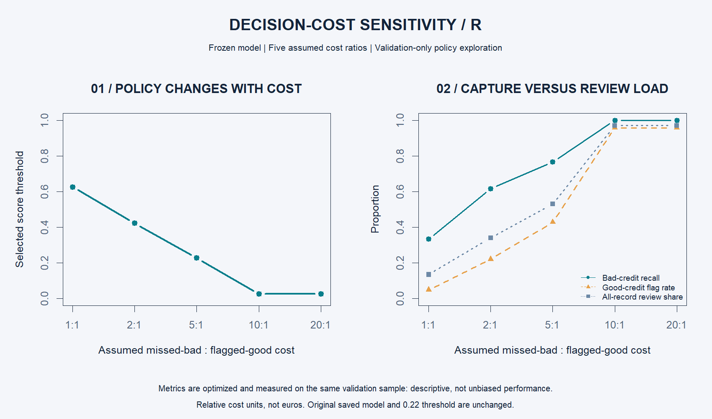

# Decision-cost sensitivity

What happens when missing a bad-credit case becomes more expensive than flagging a good-credit case? This module connects model scores to an explicit decision objective and review workload.

Run `analysis.R` to execute the complete project, including `decision_sensitivity.R`. It uses the frozen selected model's predictions on the original validation set only.

## Method

For five pre-specified missed-bad : flagged-good cost ratios (1:1, 2:1, 5:1, 10:1, 20:1), minimize `ratio * missed_bad + flagged_good`. Evaluate every distinct validation score as a threshold, plus flag-all and flag-none endpoints. Flag scores greater than or equal to the threshold. Ties favor fewer flagged records, then the highest threshold. Correct decisions have zero assumed cost.

## Observed validation trade-offs

| Cost ratio | Threshold (rounded) | Bad-credit recall | Good-credit flag rate | Total review share |
|---|---:|---:|---:|---:|
| 1:1 | 0.6260 | 33.3% | 5.0% | 13.5% |
| 2:1 | 0.4226 | 61.7% | 22.1% | 34.0% |
| 5:1 | 0.2284 | 76.7% | 42.9% | 53.0% |
| 10:1 | 0.0262 | 100.0% | 95.7% | 97.0% |
| 20:1 | 0.0262 | 100.0% | 95.7% | 97.0% |

Increasing the missed-bad cost pushes the policy toward broader review. The 10:1 and 20:1 optima are identical on this sample. Do not compare raw cost totals across cost ratios as though the units were unchanged: the penalty itself changes.

The new 5:1 threshold differs from the project's original 0.22 because this diagnostic searches exact score boundaries and uses a different explicit tie rule. The original analysis uses a 0.01 grid and selects the lowest threshold in a tie. Neither the original saved threshold nor its test results is changed. Use full-precision CSV thresholds to reproduce the flag sets.

## Limits

Threshold selection and displayed metrics use the same validation sample, making this an optimized descriptive analysis, not an unbiased generalization estimate. It does not repeatedly inspect the test set. Costs are hypothetical relative units, not euros, measured business losses, or a lending recommendation. Oversampling affects both the policy and its workload estimates. Real deployment would require representative data, justified costs, operational capacity, and independent evaluation. A review flag does not imply denial.

## Outputs and checks

`results/decision_sensitivity.csv` stores the five policies; `results/validation_policy_curve.csv` stores every candidate flag set. `results/decision_sensitivity.png` is generated in R. Assertions verify that optimized cost never exceeds flag-all or flag-none cost, flags reconcile to their components, and higher missed-bad costs do not increase missed cases in these selected policies.
