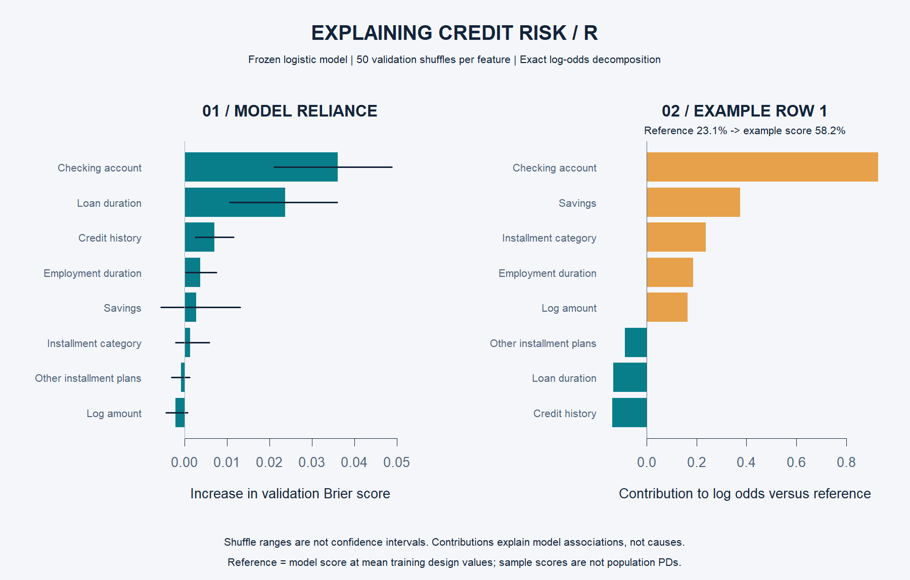

# Explaining the credit-risk model

This module adds two complementary explanations for the frozen logistic regression: overall model reliance and an exact decomposition of one score. Run `analysis.R`; it automatically runs `explainability.R`. No additional packages are required.

## Which features does the model rely on?

On the validation set, shuffle one entire predictor column at a time and recalculate Brier score without refitting. Repeat 50 times per feature. A larger increase in error means the model relies more on that feature in this sample. Factor columns are shuffled as whole variables, preserving valid categories.

| Feature | Mean increase in Brier error |
|---|---:|
| Checking-account status | 0.0361 |
| Loan duration | 0.0237 |
| Credit history | 0.0071 |

The graphic includes 5th–95th percentile ranges across shuffles. These show permutation variability, **not confidence intervals**. Near-zero or negative values mean that shuffling did not consistently worsen this sample's performance. They do not justify dropping features without new model development and independent evaluation.

Shuffling can create unrealistic combinations when predictors are correlated, so this is a measure of model reliance under perturbation, not causal importance. The analysis uses validation data and does not change the chosen model, threshold, or held-out performance claims.

## Why did this record receive its score?

The example is selected by a fixed rule: the lowest original row ID in the test set, which is row 1. It is not selected for an impressive explanation or correct outcome.

R's `predict.glm(type = "terms")` provides contributions centered on the training design matrix. The reference log odds are **−1.2047**, corresponding to a **23.1% reference score**. Adding all feature contributions gives **0.3317 log odds**; applying the logistic function gives the example's **58.2% score**.

`score = plogis(reference_log_odds + sum(feature_contributions))`

Positive bars increase modeled log odds relative to the reference; negative bars reduce them. Bars are **not percentage-point probability changes**. The reference is the model evaluated at mean training design values, potentially a fractional combination of categories; it is not an actual borrower or the average predicted probability. This is an exact additive logistic decomposition, not SHAP, a causal explanation, or an approved adverse-action reason system.

The scores remain conditional on the oversampled historical dataset and are not population default probabilities. No borrower identity is included.

## Outputs and verification

- `results/permutation_importance.csv`: feature rankings and shuffle ranges.
- `results/example_contributions.csv`: observed feature values and log-odds contributions. Source categorical codes are explained in `data/codetable.txt`.
- `results/example_score.csv`: reference, total log odds, and reconstructed score.
- `results/explainability.png`: presentation graphic generated in R.

Assertions verify that summed contributions match the model's direct log-odds prediction and reconstruct its probability to within 1e-10. They also verify complete, finite importance results.
