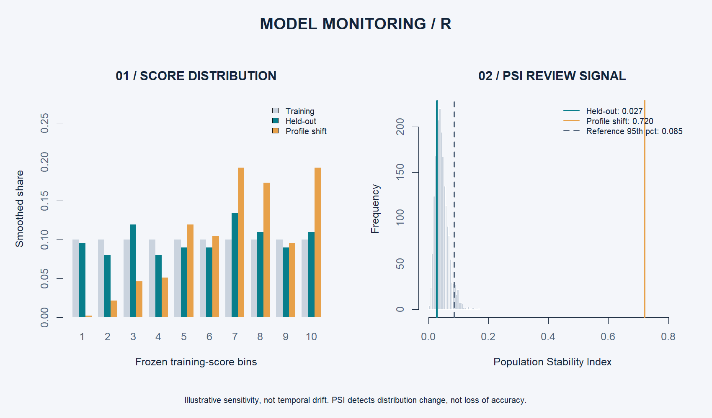

# Model monitoring: from validation to ongoing review

## Why this addition fits the role

Model monitoring supports the model-risk-management lifecycle by detecting changes in the distribution of model scores and documenting when to investigate. This module is an educational portfolio example, not a regulatory implementation.

## Run

Run `analysis.R` as usual. It automatically sources `monitoring.R` after fitting and evaluating the models. The module uses the frozen model and the original data splits.

## Design

1. Calculate training scores and freeze ten quantile bins. Duplicate cut points are removed; infinite endpoints include all future scores.
2. Compare training and held-out score distributions using **PSI = sum((current share − reference share) × log(current share / reference share))**.
3. Add 0.5 to each bin count before calculating shares, avoiding undefined logarithms for empty bins. Both distributions use this same smoothing rule.
4. Simulate 2,000 batches of 200 scores drawn with replacement from the training scores. The 95th percentile of these PSI values provides an illustrative review threshold. It is not a universal industry cutoff or a formal calibrated significance test.
5. Apply an explicit profile-shift scenario to the held-out predictors: high checking-account balances become low, low balances become negative, and loan durations rise by 25%. Other fields stay fixed. Re-score with the same model and compare distributions.

## Results and interpretation

| Comparison | PSI | Review threshold | Signal |
|---|---:|---:|---|
| Held-out sample vs training | 0.027 | 0.085 | No review flag |
| Illustrative profile shift vs training | 0.720 | 0.085 | Review flag |

Mean score rises from 31.4% to 42.8% in the designed scenario. These are **sample scores**, not population default rates. The scenario is a sensitivity exercise; there is no later-period dataset, no actual observed drift, and no outcome evidence under the modified profiles. Independently changing duration and checking status may produce unrealistic joint borrower profiles.

The empirical threshold conditions on training scores, the fitted model, bins, smoothing, and batch size. It ignores model-estimation uncertainty; changing sample size or binning changes the result. The observed held-out set is stratified, whereas the reference draws are not, so the threshold is an approximate operational illustration.

## What an analyst should do with a flag

Investigate data quality and portfolio-mix changes; identify the features and segments responsible; when outcomes mature, review discrimination, calibration, and decision costs. Document findings and decide whether further validation or recalibration is needed. A high PSI alone does not establish deteriorating performance or justify automatic retraining. A low PSI does not guarantee stable performance.

## Artifacts

- `results/monitoring_metrics.csv`: PSI, comparison threshold, mean score, and review flag.
- `results/monitoring_bins.csv`: frozen boundaries, counts, and smoothed shares.
- `results/monitoring_reference_simulation.csv`: all reference simulation values.
- `results/monitoring.png`: R-generated monitoring graphic.

Checks verify that identical reference scores produce zero PSI, values are finite/nonnegative, shares sum to one, and all scenario observations are counted.
