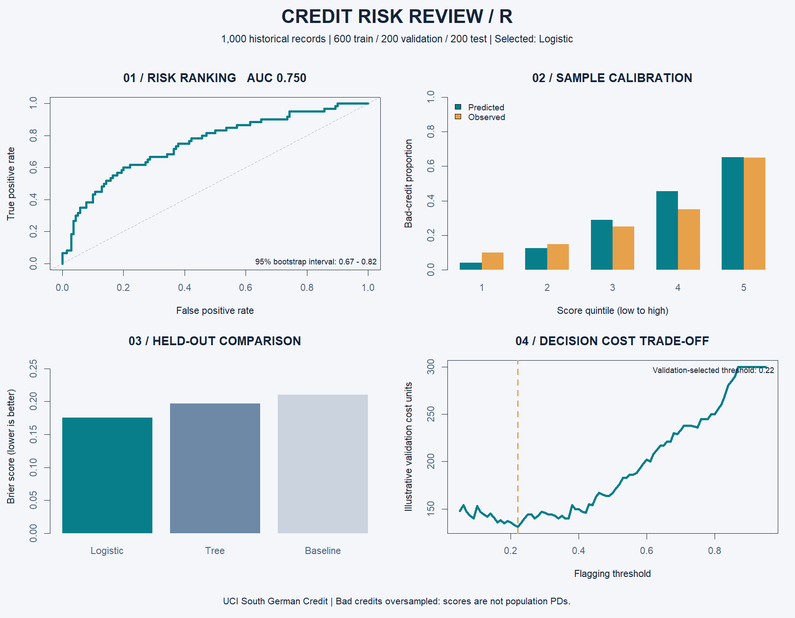

# Credit Risk Model Validation & Monitoring in R and SQL

[](https://github.com/tonykark1/credit-risk/actions/workflows/validate.yml)

**Can a compact credit model rank risk, and what does its decision threshold cost?**

**Start here:** [validation memo](VALIDATION_MEMO.md) · [visual report](report.html) · [executed SQL controls](SQL_CONTROLS.md).

**Finding:** test AUC **0.750**, Brier **0.1757** versus **0.2100** baseline. The policy catches **80% of bad credits** while flagging **46.4% of good credits**. **Recommendation:** retain as an educational benchmark; unsuitable for lending deployment. Historical oversampled data do not establish population default probabilities.

A reproducible financial-risk portfolio project using public historical records, logistic regression, a shallow decision-tree challenger, and separate training, validation, and test sets. Built with AI assistance. All analysis and graphics run in R.



## Run

Open `credit-risk-r.Rproj` in RStudio, open `analysis.R`, and click **Source**. Or, from the project folder:

```r
source("analysis.R")
```

Terminal alternative: `Rscript analysis.R`. Uses base R and `rpart`, which normally ships with R. If absent, run `install.packages("rpart")`. Data and completed results are bundled, so no download is needed. Tested with R 4.6.1; exact environment recorded in `results/sessionInfo.txt`.

## What makes this a risk project

- **Executed SQL controls:** run `python run_sql_checks.py` after the R analysis. All 12 controls and five injected-fault tests passed. Uses Python 3.10+ and its standard-library SQLite driver, with no extra packages. SQL source is in `sql/`; modeling stays in R.

- **Honest data treatment:** scores describe the sampled dataset, not population default probabilities.
- **Leakage-aware evaluation:** 600 training / 200 validation / 200 test records, stratified by outcome. Neither model selection nor threshold choice uses test results.
- **Interpretable benchmark and challenger:** logistic regression versus a depth-three decision tree, plus a constant-score baseline.
- **Uncertainty:** 1,000 test-set bootstrap resamples give a conditional AUC interval.
- **Decision trade-offs:** an explicit assumed 5:1 cost for missed bad credits versus wrongly flagged good credits, with threshold chosen on validation data.

## Verified results

| Model | Validation Brier | Test AUC | Test Brier |
|---|---:|---:|---:|
| Logistic regression | 0.1805 | 0.750 | 0.1757 |
| Shallow decision tree | 0.1946 | 0.672 | 0.1966 |
| Constant 30% score | 0.2100 | 0.500 | 0.2100 |

Logistic regression was selected by validation Brier score. Its test AUC bootstrap 95% interval is **0.673–0.817**, and its Brier score is 16.3% below the baseline. This is one split, not evidence of a statistically significant superiority across populations.

At the validation-selected threshold of **0.22**:

| Test outcome | Not flagged | Flagged |
|---|---:|---:|
| Good credit | 75 | 65 |
| Bad credit | 12 | 48 |

The model catches **80%** of bad-credit cases while flagging **46.4%** of good-credit cases. Assumed test cost is **125 units**, versus 140 for flagging everyone and 300 for flagging nobody. These are illustrative cost units, not euros or projected savings. The threshold is specific to this sample and cost assumption.

## Modeling choices

Eight pre-specified predictors keep the project compact: checking-account status, duration, log transformed amount, credit history, savings, employment duration, installment category, and other installment plans. Categorical codes are converted to factors using the source codebook; they are not treated as arbitrary continuous numbers. `bad = 1 - kredit` makes bad credit the positive class.

The tree has fixed depth 3, complexity parameter 0.01, and minimum split size 40. The logistic model uses R's binomial `glm`. The training models are retained without refitting after validation, so the chosen threshold applies to the same fitted model. The threshold grid is 0.05–0.95 in 0.01 increments; ties select the lowest threshold. Equal-count calibration groups contain 40 test records each; tied scores are assigned by row order.

Age, combined personal-status/sex, and foreign-worker fields are omitted. This choice does **not** establish fairness: remaining predictors can be proxies, and no fairness audit is claimed.

## Data provenance

Source: [UCI South German Credit](https://archive.ics.uci.edu/dataset/573/south+german+credit+update), DOI [10.24432/C5QG88](https://doi.org/10.24432/C5QG88), licensed [CC BY 4.0](https://creativecommons.org/licenses/by/4.0/). Retrieved 11 October 2026. The 1,000 records contain 700 good and 300 bad credits from 1973–1975; bad credits were oversampled. The dataset supplies corrected coding information. Original data and codebook are preserved in `data/`; transformations occur in `analysis.R`. The source amount is transformed and cannot support a defensible euro loss estimate. The label concerns contract compliance, not a documented 12-month default horizon.

## Limitations worth discussing

Historical data, outcome-dependent sampling, only 200 test observations, and a single split limit generalization. Sample calibration does not establish population PD calibration. The bootstrap interval conditions on the fitted model and does not capture training or model-selection uncertainty. No temporal validation, causal interpretation, population correction, deployment, or regulatory compliance is claimed. A current representative dataset, time-based validation, repeated training evaluation, calibration review, and justified decision costs would be needed for a serious next version.

## Repository map

### Added: decision-cost sensitivity

`decision_sensitivity.R` explores five assumed error-cost ratios using validation data only. Review share rises from **13.5% at 1:1** to **97% at 10:1**, illustrating the operational consequences of cost assumptions. See [the decision brief](DECISION_SENSITIVITY.md). These optimized validation metrics are descriptive; original test results and the saved 0.22 threshold are unchanged.

### Added: repeated-split robustness

`robustness.R` runs 50 stratified splits of the 800 development records, excluding the original test set. Logistic regression achieves mean validation AUC **0.754** and beats the tree on Brier in **48/50** runs. Overlapping splits make this a descriptive sensitivity check, not an independent significance test. See [robustness results](ROBUSTNESS.md) and [full execution log](results/run_log.txt). Running `analysis.R` executes all modules automatically.

### Added: model explainability

`explainability.R` ranks feature reliance using 50 validation permutations per predictor and reconstructs an example score from exact additive log-odds contributions. Checking-account status and duration lead the ranking. See [the explanation brief](EXPLAINABILITY.md) and [shareable graphic](results/explainability.png). This is descriptive model explanation, not causal analysis; the model and decision threshold remain frozen.

### Added: model monitoring

`analysis.R` now also runs `monitoring.R`: frozen training-score bins, Population Stability Index (PSI), and an illustrative profile-shift sensitivity. Held-out PSI is **0.027**; scenario PSI is **0.720**, above a simulated review threshold of **0.085**. This demonstrates distribution monitoring, not observed temporal drift or proven accuracy deterioration. See [the monitoring brief](MONITORING.md) and [monitoring graphic](results/monitoring.png).

- `analysis.R`: complete analysis and numerical assertions.
- `results/project_summary.png`: ready-to-post graphic generated in R.
- `results/test_metrics.csv`, `validation_metrics.csv`: separate scorecards.
- `results/test_predictions.csv`, `split_manifest.csv`: auditable outcomes and splits.
- `results/logistic_odds_ratios.csv`: estimates and approximate Wald intervals.
- `results/models.rds`: fitted models and chosen threshold.
- `report.html`: readable local results brief (open in a browser).

Checks verify source dimensions and label counts, convergence, disjoint splits, metric behavior on known examples, valid predictions, and complete result counts. No employer affiliation is implied.

