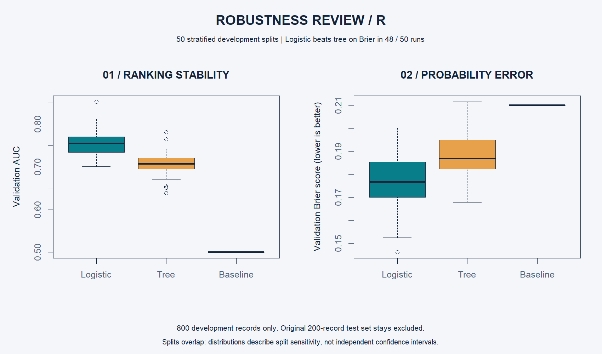

# Robustness across data splits

Does the comparison depend heavily on one lucky split? `robustness.R` evaluates the fixed logistic and tree specifications across 50 stratified random splits of the original 800 development records. Each run fits on 600 records and evaluates on 200. The original 200-record test set is excluded throughout.

Run `analysis.R` to execute this module and all earlier modules. The full project was executed successfully with R 4.6.1; see `results/run_log.txt`. R emitted startup locale warnings, but all modeling and numerical assertions completed.

| Model | Mean validation AUC | AUC 5th–95th percentiles | Mean validation Brier |
|---|---:|---:|---:|
| Logistic | 0.754 | 0.709–0.801 | 0.1769 |
| Shallow tree | 0.706 | 0.653–0.742 | 0.1881 |
| Constant baseline | 0.500 | 0.500–0.500 | 0.2100 |

Logistic regression has a lower Brier score than the tree in **48 of 50** paired runs. Both models use the same split in each run, making the comparison paired. No settings are tuned, no threshold is reselected, and the saved final models are not overwritten. Seeds 5001 through 5050 make the diagnostic reproducible.

The distributions show sensitivity to training and validation composition. The splits overlap, so the runs are not independent observations: percentile ranges are **not confidence intervals**, and the win count is **not a significance test**. The diagnostic reuses development data previously involved in model selection. It is descriptive evidence, not a new external validation. It does not assess time drift, population calibration, or decision-threshold stability.

Outputs: `results/robustness_runs.csv` contains all 150 model/run rows; `results/robustness_summary.csv` contains aggregates; `results/robustness.png` is the R-generated graphic. Assertions check split separation, original-test exclusion, convergence, complete results, and metric bounds.
